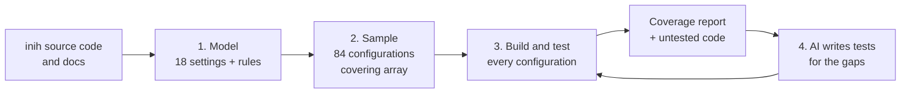

# Results: AI-assisted combinatorial interaction testing of inih

Pilot study for ENS 491 Project 516. Subject: [inih](https://github.com/benhoyt/inih) (a small C library that reads `.ini` files) at commit `611ab51`. Every number below is generated from the pipeline outputs by `make_results.py`; rerun `./run_pipeline.sh && python3 make_results.py` to reproduce.

> **Status:** pilot results. The reference model and the three bugs are pending confirmation by the team; the AI tests were generated by Claude (claude-opus-5-5) acting as the test-generation agent.

## How it works

1. **Model:** list the library's settings, the values to test for each, and which combinations are not allowed.
2. **Sample:** instead of millions of combinations, pick a small set of configurations in which every pair of settings (and every triple in high-risk areas) appears at least once: a *covering array*.
3. **Build and test:** compile inih in each configuration, run the tests, measure which code ran, and check for memory errors.
4. **AI tests:** give an AI agent the list of code that never ran; it writes targeted tests; repeat until nothing reachable is left.

## Results at a glance

| | Developer tests | + Covering array | + AI tests |
|---|---|---|---|
| Configurations tested | 13 | 84 | 94 |
| Code lines executed (statement coverage) | 94.2% | 97.1% | **100.0%** |
| Decision outcomes taken (branch coverage) | 80.7% | 90.3% | **94.4%** |
| Functions entered | 100.0% | 100.0% | 100.0% |
| Pairs of settings tested together | 34.7% | 100.0% | 100.0% |
| Bugs found | 0 | 0 | **3** |

## 1. The model: 18 settings

*Compile-time* settings need a rebuild; *runtime* settings are chosen by the program using inih. "Values tested" are representatives of value ranges that behave the same.

| Setting | What it controls | Kind | Default | Values tested | Only matters when |
|---|---|---|---|---|---|
| `INI_HANDLER_LINENO` | Pass the line number to the program's callback | compile-time | `0` | 0, 1 |  |
| `INI_ALLOW_MULTILINE` | Indented lines continue the previous value | compile-time | `1` | 1, 0 |  |
| `INI_ALLOW_BOM` | Skip a UTF-8 byte-order mark at the start of the file | compile-time | `1` | 1, 0 |  |
| `INI_START_COMMENT_PREFIXES` | Characters that start a comment line | compile-time | `";#"` | ";#", ";", "#", "" |  |
| `INI_ALLOW_INLINE_COMMENTS` | Allow comments after a value on the same line | compile-time | `1` | 1, 0 |  |
| `INI_INLINE_COMMENT_PREFIXES` | Characters that start an inline comment | compile-time | `";"` | ";", "#", ";#" | INI_ALLOW_INLINE_COMMENTS == 1 |
| `INI_USE_STACK` | Line buffer on the stack (1) or the heap (0) | compile-time | `1` | 1, 0 |  |
| `INI_MAX_LINE` | Line buffer size = longest line that fits | compile-time | `200` | 2, 20, 200, 4096 | INI_USE_STACK == 1 or INI_ALLOW_REALLOC == 1 |
| `INI_MAX_SECTION` | Longest section name kept | compile-time | `50` | 1, 8, 50, 256 |  |
| `INI_MAX_NAME` | Longest key name kept (used for continuation lines) | compile-time | `50` | 1, 8, 50, 256 | INI_ALLOW_MULTILINE == 1 |
| `INI_ALLOW_REALLOC` | Heap buffer may grow for long lines | compile-time | `0` | 0, 1 | INI_USE_STACK == 0 |
| `INI_INITIAL_ALLOC` | Starting size of the heap buffer | compile-time | `200` | 2, 5, 20, 200 | INI_USE_STACK == 0 |
| `INI_STOP_ON_FIRST_ERROR` | Stop reading at the first error | compile-time | `0` | 0, 1 |  |
| `INI_CALL_HANDLER_ON_NEW_SECTION` | Call the program at every [section] header | compile-time | `0` | 0, 1 |  |
| `INI_ALLOW_NO_VALUE` | Allow keys without '=' (value is NULL) | compile-time | `0` | 0, 1 |  |
| `INI_CUSTOM_ALLOCATOR` | Use the program's own malloc/free | compile-time | `0` | 0, 1 | INI_USE_STACK == 0 |
| `api_entry_point` | Which parse function the program calls (file name, FILE*, stream, string) | runtime | `"ini_parse"` | "ini_parse", "ini_parse_file", "ini_parse_stream", "ini_parse_string", "ini_parse_string_length" |  |
| `handler_return_policy` | How the program's callback answers (accept all, reject one key, reject all) | runtime | `"reject_flagged"` | "reject_flagged", "accept_all", "reject_all" |  |

**Rules between settings** (constraints):

| Rule | Meaning | Type | Status |
|---|---|---|---|
| `if INI_CUSTOM_ALLOCATOR == 1 then INI_USE_STACK == 0` | A custom allocator only works with the heap buffer (stated in `ini.h`). | not allowed | confirmed |
| `if INI_USE_STACK == 0 and INI_ALLOW_REALLOC == 1 then INI_INITIAL_ALLOC <= INI_MAX_LINE` | With a growing heap buffer, the starting size should not exceed the maximum line size, or the maximum is never enforced. | allowed but contradictory | confirmed |
| `if INI_USE_STACK == 0 and INI_ALLOW_REALLOC == 0 then INI_INITIAL_ALLOC == INI_MAX_LINE` | Without growth, the heap buffer size *is* the line limit, so `INI_MAX_LINE` is ignored; the two should match. | allowed but contradictory | confirmed |
| `if INI_ALLOW_MULTILINE == 1 then INI_MAX_NAME >= 2` | With a 1-byte name buffer, multi-line values silently stop working (found by AI test, bug F3). | allowed but contradictory | confirmed |
| `if INI_USE_STACK == 0 and INI_ALLOW_REALLOC == 1 then INI_INITIAL_ALLOC < INI_MAX_LINE` | If the starting size equals the maximum, enabling growth has no effect (AI hypothesis, not yet tested). | allowed but contradictory | hypothesis |

## 2. Why sampling: the size of the configuration space

| | Configurations | Separate builds |
|---|---|---|
| All combinations of the tested values | 47,185,920 | – |
| …that respect the rules | 35,389,440 | 450,560 |
| Developer test suite (`tests/meson.build`) | 16 variants | 13 |
| **Covering array** (all pairs + high-risk triples) | **84** (16 developer + 68 new) | **48** |

Running the whole covering array (build, test, coverage, memory checks) took **51 seconds**.

## 3. Which setting combinations the developer tests miss

High-risk areas are groups of settings that control the same code; for these, every *triple* of values is required.

| Area | Settings | Combinations required | Developer tests | Covering array |
|---|---|---|---|---|
| All settings, every pair | 18 (pairs) | 1,209 | 419 (34.7%) | 1,209 (100.0%) |
| Line buffer: stack vs heap, growth, sizes | 4 (triples) | 61 | 20 (32.8%) | 61 (100.0%) |
| Custom memory allocator | 3 (triples) | 5 | 4 (80.0%) | 5 (100.0%) |
| Input reader × buffer growth | 3 (triples) | 40 | 8 (20.0%) | 40 (100.0%) |
| Multi-line values × comments × name size | 4 (triples) | 78 | 10 (12.8%) | 78 (100.0%) |
| Keys without values × multi-line × callback | 3 (triples) | 12 | 4 (33.3%) | 12 (100.0%) |
| Error handling: stop-on-error × callback answer × section callback | 3 (triples) | 12 | 4 (33.3%) | 12 (100.0%) |
| Comment characters (line start vs inline) | 3 (triples) | 16 | 2 (12.5%) | 16 (100.0%) |
| **Total** | | **1,433** | **471 (32.9%)** | **1,433 (100.0%)** |

## 4. Code coverage per function of `ini.c`

| Function | Lines | Developer tests | + Covering array | + AI tests |
|---|---|---|---|---|
| `ini_rstrip` | 47–52 | 4/4 | 4/4 | 4/4 |
| `ini_lskip` | 55–60 | 4/4 | 4/4 | 4/4 |
| `ini_find_chars_or_comment` | 65–80 | 9/9 | 9/9 | 9/9 |
| `ini_strncpy0` | 84–92 | 5/5 | 5/5 | 5/5 |
| `ini_parse_stream` | 95–270 | 75/83 (90%) | 79/83 (95%) | 83/83 |
| `ini_parse_file` | 273–277 | 3/3 | 3/3 | 3/3 |
| `ini_parse` | 280–291 | 7/7 | 7/7 | 7/7 |
| `ini_reader_string` | 295–318 | 18/18 | 18/18 | 18/18 |
| `ini_parse_string` | 321–323 | 2/2 | 2/2 | 2/2 |
| `ini_parse_string_length` | 326–334 | 4/4 | 4/4 | 4/4 |

## 5. The AI-generated tests

The agent received the list of code that never ran and wrote 12 tests. A test counts as **valid** only if its configuration respects the rules, it builds, it runs, it has an expected result, and it really executes the code it aimed at. **12 of 12 were valid.**

| Test | What it tries | Settings changed | Hit its target | Result |
|---|---|---|---|---|
| `t_failmalloc` | Memory allocation fails at the start: the parser must give up cleanly (return -2) | `INI_USE_STACK=0`, `INI_CUSTOM_ALLOCATOR=1` + simulated memory failure | yes | passed |
| `t_failrealloc` | Buffer growth fails in the middle of a line: the parser must free memory and return -2 | `INI_USE_STACK=0`, `INI_CUSTOM_ALLOCATOR=1`, `INI_ALLOW_REALLOC=1`, `INI_INITIAL_ALLOC=5` + simulated memory failure | yes | passed |
| `t_realloc_eof` | File ends exactly when the growing buffer is full | `INI_USE_STACK=0`, `INI_ALLOW_REALLOC=1`, `INI_INITIAL_ALLOC=5` | yes | passed |
| `t_realloc_cap_boundary` | Buffer grows 2→4→8→16→20 (capped); lines of 18 and 19 characters | `INI_USE_STACK=0`, `INI_ALLOW_REALLOC=1`, `INI_INITIAL_ALLOC=2`, `INI_MAX_LINE=20` | yes | passed |
| `t_abyss_nul` | Too-long line containing a NUL byte, followed by a normal line | `INI_MAX_LINE=20` | yes | **found bug F1** |
| `t_maxline_lf_boundary` | Lines of 17, 18 and 19 characters with a 20-byte buffer (Unix line endings) | `INI_MAX_LINE=20` | yes | passed |
| `t_maxline_crlf_boundary` | Same boundary with Windows line endings (\r\n) | `INI_MAX_LINE=20` | yes | passed |
| `t_bom_partial` | File starts with only 2 of the 3 byte-order-mark bytes | defaults | yes | passed |
| `t_maxname_trunc_continuation` | Long key continued on the next line, with an 8-byte name buffer | `INI_MAX_NAME=8` | yes | **found bug F2** |
| `t_maxname1_multiline` | Continued value with a 1-byte name buffer | `INI_MAX_NAME=1` | yes | **found bug F3** |
| `t_maxsection_trunc` | Section names of 7 and 8 characters with an 8-byte buffer | `INI_MAX_SECTION=8` | yes | passed |
| `t_stop_on_section_reject` | Callback rejects a section while stop-on-first-error is on | `INI_STOP_ON_FIRST_ERROR=1`, `INI_CALL_HANDLER_ON_NEW_SECTION=1`, `handler_return_policy="reject_all"` | yes | passed |

The AI test run: 10 configurations, 10 builds, 10 seconds.

## 6. Bugs found

None of these is caught by inih's own test suite. Each was reproduced with a small standalone program (see `docs/team_checks_guide.md`, Check 3).

| ID | What goes wrong | Needs | Severity | Kind | Found by |
|---|---|---|---|---|---|
| **F1** | A too-long line whose cut-off part starts with a NUL byte makes inih silently **skip the next, valid line**. | Any build (default included); needs a NUL byte in the file | Low (data loss, unusual input) | Robustness bug | `t_abyss_nul` |
| **F2** | The continuation of a long key arrives under a **shortened, different key** (`longname_x=first`, then `longnam=second`). | `INI_ALLOW_MULTILINE=1` × small `INI_MAX_NAME` (default 50: keys of 50+ characters) | Low–medium (value stored under the wrong key) | Interaction bug + documentation mismatch | `t_maxname_trunc_continuation` |
| **F3** | `INI_MAX_NAME=1` (allowed) **silently disables multi-line values**: the continuation becomes a syntax error. | `INI_ALLOW_MULTILINE=1` × `INI_MAX_NAME=1` | Low (unusual setting) | Configuration pitfall → new rule C4 | `t_maxname1_multiline` |

## 7. Code that is still never executed, and why

After the AI tests, 7 decision outcomes remain untaken. The agent explained each one, and none can be reached by any input in any allowed configuration:

| Location | Reason |
|---|---|
| `ini.c:75:2` | Handles a 'no characters given' case that cannot occur when inline comments are off |
| `ini.c:124:0` | Safety check (`assert`): only fails if a programmer passes NULL |
| `ini.c:125:0` | Safety check (`assert`): only fails if a programmer passes NULL |
| `ini.c:126:0` | Safety check (`assert`): only fails if a programmer passes NULL |
| `ini.c:190:3` | Empty-line case already handled earlier as a comment (redundant check) |
| `ini.c:221:1` | Same redundant empty-line check |
| `ini.c:302:2` | Needs a buffer smaller than 2 bytes, below the allowed minimum |

So the feedback loop stopped after one round (converged: **True**).

## 8. How well the model can be discovered automatically (RQ1, static analysis only)

Compared against the reference model in `csm.yaml`, without any AI help:

| What | Found correctly |
|---|---|
| Settings | 18 / 18 |
| Kind (compile-time / runtime) and type | 18 / 18 |
| Default values | 17 / 18 (the miss: the runtime callback setting uses different value names) |
| "Only matters when" conditions | 6 / 6 |
| Smallest safe value of numeric settings | 4 / 4 |
| Build-system names for the settings | 15 / 15 |
| Rules between settings | 0 / 4 |
| High-risk setting pairs | 9 / 25 (no false ones) |

Static analysis finds the settings almost perfectly but none of the rules, because inih states its rules only in comments. Recovering them is the job of the AI discovery step (next experiment).

